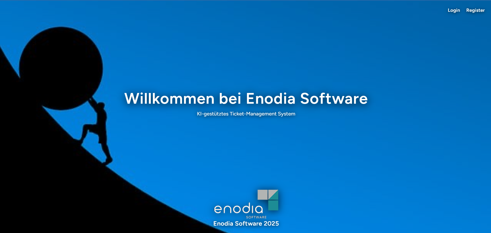

# 🎫 Project-X KI — KI-gestütztes Ticket-Management System

<p align="center">
  
</p>

<p align="center">
  <strong>Ein intelligentes, KI-gestütztes IT-Ticket- und Kunden-Management-System</strong><br>
  Entwickelt im Rahmen des IHK-Abschlussprojekts (Fachinformatiker für Anwendungsentwicklung) bei der <strong>Enodia Software GmbH</strong>.
</p>

<p align="center">
  <a href="https://project-x-ki.laravel.cloud/"></a>
  <a href="https://laravel.com/"></a>
  <a href="https://inertiajs.com/"></a>
  <a href="https://tailwindcss.com/"></a>
  <a href="https://php.net/"></a>
</p>

---

## 🌟 Über das Projekt (About the Project)

**Project-X KI** ist eine moderne Enterprise-Webanwendung zur Automatisierung und Optimierung von IT-Supportprozessen. Das System unterstützt Support-Teams und Administratoren durch intelligente KI-Funktionen bei der Analyse, Priorisierung und Bearbeitung von Kundenanfragen.

Das Projekt entstand als praxisnahe Abschlussarbeit für die **IHK-Prüfung** (Fachinformatiker Anwendungsentwicklung) in Kooperation mit der **Enodia Software GmbH**.

> 🔒 **Hinweis zum Datenschutz (DSGVO / GDPR Compliance):**  
> Zum Schutz interner Unternehmensdaten und zur Einhaltung der Datenschutz-Grundverordnung (DSGVO) läuft die öffentliche Live-Demo in einer **Sandbox-Umgebung mit sicheren, synthetischen Testdaten (Mock Data)**. Sämtliche Ticketinhalte, Kundennamen und Kontaktdaten sind fiktiv.

---

## 🚀 Live Demo

- **URL:** [https://project-x-ki.laravel.cloud/](https://project-x-ki.laravel.cloud/)
- **Hosting:** Laravel Cloud

---

## ✨ Kernfunktionen (Key Features)

### 🧠 1. KI-gestützte Ticket-Analyse (`tickets.analyse`)
- **Automatische Klassifizierung:** Erkennung von Fehlerkategorie, Dringlichkeit und Sentiment des Kunden.
- **Intelligente Lösungsvorschläge:** KI-basierte Vorab-Analyse zur Beschleunigung der Bearbeitungszeit.
- **Dringlichkeits-Scoring:** Automatische Zuweisung von Prioritäten (Low, Medium, High, Critical).

### 🎫 2. Ticket-Lebenszyklus-Management (`tickets.list`, `tickets.search`)
- Vollständiges Ticket-Tracking vom Eingang bis zum Abschluss.
- Leistungsstarke Volltextsuche und Filterung nach Status, Kunde und Bearbeiter.
- Status-Workflows: *Offen*, *In Bearbeitung*, *Warten auf Kunde*, *Gelöst*.

### 👥 3. Kundenverwaltung (`kunden.list`)
- Übersicht aller betreuten Unternehmen und Ansprechpartner.
- Verknüpfung historischer Tickets mit Kundenprofilen für vollständige Transparenz.

### 📊 4. Dashboard & Analytics (`dashboard`)
- Echtzeit-Statistiken über offene vs. gelöste Tickets.
- Auswertung der durchschnittlichen Lösungszeiten und Support-Belastung.
- Berechtigungs- und Rollenmanagement für Agenten und Administratoren.

---

## 🛠️ Technologie-Stack (Tech Stack)

| Bereich | Technologie |
|---|---|
| **Backend Framework** | [Laravel 11](https://laravel.com/) |
| **Frontend Integration** | [Inertia.js](https://inertiajs.com/) & Modern Component Architecture |
| **Styling** | [Tailwind CSS](https://tailwindcss.com/) |
| **Sprache** | PHP 8.2+ / Modern JavaScript |
| **Routing & State** | Ziggy Routing, RESTful Controllers |
| **Authentifizierung** | Laravel Sanctum / Breeze (Role-Based Access) |
| **Hosting & Cloud** | Laravel Cloud Edge Platform |

---

## 💻 Lokale Installation (Local Setup)

Voraussetzungen:
- PHP >= 8.2
- Composer
- Node.js & npm
- MySQL oder SQLite

```bash
# 1. Repository klonen
git clone https://github.com/Ploger1979/project-x-ki.git
cd project-x-ki

# 2. PHP-Abhängigkeiten installieren
composer install

# 3. Frontend-Abhängigkeiten installieren
npm install

# 4. Umgebungsvariablen konfigurieren
cp .env.example .env
php artisan key:generate

# 5. Datenbank migrieren und Testdaten einspielen
php artisan migrate --seed

# 6. Assets kompilieren & Server starten
npm run dev
php artisan serve
```

---

## 👤 Entwickler & Kontakt (Author)

**Ayman Plöger**  
*Fachinformatiker für Anwendungsentwicklung | Full-Stack Web Developer*  
- **Portfolio:** [aymanbyte-portfolio.netlify.app](https://aymanbyte-portfolio.netlify.app/)
- **GitHub:** [@Ploger1979](https://github.com/Ploger1979)
- **LinkedIn:** [Ayman Plöger](https://www.linkedin.com/in/ayman-pl%C3%B6ger/)
- **E-Mail:** [aymanploger@gmail.com](mailto:aymanploger@gmail.com)

---

## 📄 Lizenz (License)
Dieses Projekt wurde zu Ausbildungs- und Demonstrationszwecken entwickelt. Alle Rechte an Marken und Namen der Enodia Software GmbH verbleiben bei den jeweiligen Rechteinhabern.
