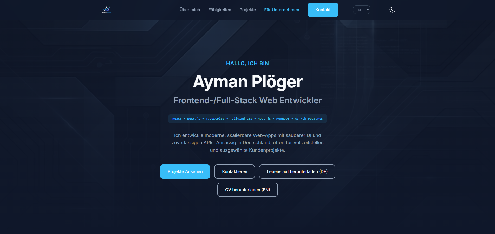

# 🚀 AymanByte – Flagship Portfolio & Full-Stack Solutions Showcase

[](https://aymanbyte-portfolio.netlify.app/)
[](https://aymanbyte-portfolio.netlify.app/clients.html)
[](https://developer.mozilla.org/en-US/docs/Web/JavaScript)
[](https://developer.mozilla.org/en-US/docs/Web/CSS)
[](https://aymanbyte-portfolio.netlify.app/)
[](https://aymanbyte-portfolio.netlify.app/)
[](https://www.netlify.com/)

> **The personal engineering showcase and commercial solutions platform of Ayman Plöger (AymanByte).** Architected with high-performance Vanilla Web Technologies (HTML5, Modern CSS custom properties, and modular ES6+ JavaScript), featuring dynamic tri-lingual internationalization (German, English, Arabic RTL), dual audience portals (Developer Deep-Dive & Executive Client Services), an adaptive dark/light mode engine, and direct access to enterprise-grade production projects.

---

## 📸 Preview



---

## 🧭 Dual-Mode Architecture

The platform is designed with two distinct operational experiences to serve both technical evaluators and commercial business clients:

| Experience | URL / Path | Target Audience | Primary Focus |
| :--- | :--- | :--- | :--- |
| **Developer Deep-Dive** | [`index.html`](file:///d:/Alle%20mein%20Projekte/ALT_PROJEKTES/Portfolio-Final/index.html) | Technical Recruiters, Engineering Leads & CTOs | Skills radar, architecture breakdowns, GitHub repositories, experience timeline & downloadable CVs. |
| **Business Solutions Portal** | [`clients.html`](file:///d:/Alle%20mein%20Projekte/ALT_PROJEKTES/Portfolio-Final/clients.html) | Direct Clients, Founders & Business Owners | Commercial services, project delivery roadmap, client case studies, ROI value proposition & direct consultation booking. |

---

## 🌟 Key Features

- **🌐 Dynamic Tri-Lingual i18n Engine:** Seamless runtime switching between **German (DE)**, **English (EN)**, and **Arabic (AR)** via localized `data-i18n` dictionaries with automatic Right-to-Left (RTL) layout transformation and tailored typography.
- **🌗 Adaptive Dual Theme Engine:** High-contrast Cyberpunk Obsidian Dark Mode and crisp Clean Light Mode powered by CSS custom properties and instant persistent `localStorage`.
- **⚡ Zero-Dependency Performance:** Pure Vanilla JavaScript and CSS with zero heavy bundle overhead, ensuring lightning-fast load times, near-instant First Contentful Paint (FCP), and flawless 60 FPS transitions.
- **📄 Interactive Curriculum Vitae Hub:** Integrated PDF preview modals and instant download triggers for curated technical CVs in both German and English.
- **📱 Fluid Mobile-First Responsive Design:** Mobile drawer navigation, active scrollspy navbar highlighting, and smooth touch-optimized gestures across all viewports.
- **🛡️ Clean Privacy-Compliant Architecture:** Static edge deployment with zero invasive trackers, GDPR-friendly structure, and accessible semantic HTML5.

---

## 🏆 Featured Production Projects

A curated selection of live production web applications and enterprise platforms developed by **Ayman Plöger**:

| Project | Tech Stack | Live Demo | Repository |
| :--- | :--- | :---: | :---: |
| **🚚 Zusammen Umzüge** | Next.js 16, React 19, Gemini AI, DIN 5008 PDF Invoices, MongoDB | [Live Website](https://zusammenumzuege.de/) | [GitHub Code](https://github.com/Ploger1979/zusammen-umzuege-platform) |
| **🤖 Project-X KI** | Next.js 15, AI Automation, Enterprise Ticket Management | — | [GitHub Code](https://github.com/Ploger1979/project-x-ki) |
| **🔮 Selina Zazou (Kartenlegen)** | React 18, Vite, Framer Motion, PayPal Smart Buttons, MongoDB | [Live Website](https://kartenlegen-selinazazou.org/) | [GitHub Code](https://github.com/Ploger1979/kartenlegen-website) |
| **🛏️ Al-Najah Company** | Next.js 15, React 19, E-Commerce & Manufacturing, 4-Tier RBAC, Playwright | [Live Website](https://alnajah-company.com/) | [GitHub Code](https://github.com/Ploger1979/alnajah-project) |
| **🌙 Khushu App** | Next.js 16, PWA Offline-First, Serwist, Web Audio API, Authentic Adhkar | [Live Demo](https://khushu-app.netlify.app/) | [GitHub Code](https://github.com/Ploger1979/Khushu) |
| **✨ Al Siraj Perfumes** | Next.js 15, Luxury Perfumery E-Commerce, MongoDB, Cloudinary | [Live Website](https://alsiraj-perfumes.com/) | [GitHub Code](https://github.com/Ploger1979/alsiraj-perfumes-shop) |
| **🌿 Nabatek Dawak** | Next.js 15, React 19, Multilingual Botanical Encyclopedia, i18next | [Live Demo](https://nabatek-dawak.netlify.app/) | [GitHub Code](https://github.com/Ploger1979/nabatek-dawak) |

---

## 🛠️ Tech Stack & Architecture

| Layer | Technology | Details |
| :--- | :--- | :--- |
| **Structure** | [HTML5 Semantic Elements](https://developer.mozilla.org/en-US/docs/Glossary/Semantics) | Accessible landmark structure (`<header>`, `<main>`, `<article>`, `<footer>`) |
| **Styling** | [Modern CSS3](https://developer.mozilla.org/en-US/docs/Web/CSS) | CSS Variables, Flexbox, Grid, Glassmorphism & Keyframe Animations |
| **Logic** | [Vanilla JavaScript (ES6+)](https://developer.mozilla.org/en-US/docs/Web/JavaScript) | Modular script architecture, IntersectionObserver, and DOM state handling |
| **Internationalization** | Custom i18n Engine | Client-side dictionary lookups, RTL attribute toggling & persistent language cache |
| **Iconography** | [Ionicons](https://ionic.io/ionicons) | Lightweight SVG vector iconography |
| **Hosting & CI/CD** | [Netlify](https://www.netlify.com/) | Automated continuous deployment linked to GitHub `main` branch |

---

## 🚀 Local Development & Setup

### Prerequisites

No complex toolchains or package managers are required. You only need a modern web browser.

### Running Locally

1. **Clone the repository:**
   ```bash
   git clone https://github.com/Ploger1979/portfolio.git
   cd portfolio
   ```

2. **Serve the project:**
   You can open `index.html` directly in any web browser, or launch a local development server:
   ```bash
   # Using VS Code Live Server extension, OR:
   npx serve .
   ```

3. **Navigate:**
   - Developer Portfolio: [http://localhost:3000/index.html](http://localhost:3000/index.html)
   - Client Business Portal: [http://localhost:3000/clients.html](http://localhost:3000/clients.html)

---

## 📦 Project Directory Structure

```plaintext
portfolio/
├── index.html            # Main developer portfolio & technical showcases
├── clients.html          # Executive client solutions & commercial services
├── css/                  # Modular stylesheet architecture
│   ├── main.css          # Design tokens, variables & typography
│   ├── responsive.css    # Responsive breakpoints & mobile drawer
│   └── components/       # Component-specific styles
├── js/                   # Client-side scripts
│   ├── script.js         # i18n dictionary, theme switcher & scroll logic
│   └── translations/     # Localized string definitions (DE, EN, AR)
├── images/               # Project showcase photography & branding media
├── assets/
│   └── cv/               # Professional CV files (German & English PDF)
└── netlify.toml          # Netlify headers & redirect rules
```

---

## 👨‍💻 Author

**Ayman Plöger**  
*Full-Stack Web Developer & Digital Solutions Architect*  

- **Portfolio:** [aymanbyte-portfolio.netlify.app](https://aymanbyte-portfolio.netlify.app/)  
- **GitHub:** [@Ploger1979](https://github.com/Ploger1979)  
- **LinkedIn:** [Ayman Plöger](https://www.linkedin.com/in/ayman-pl%C3%B6ger/)  
- **Email:** [aymanploger@gmail.com](mailto:aymanploger@gmail.com)

---

## 📄 License

This project is open-source and available under the [MIT License](LICENSE).
